---
title:
- Correction TD 1
subtitle:
- Ingénierie des systèmes
author:
- Jean-Yves Didier
lang:
- french
date:
- 2026-2027
fontsize: 
- 12pt
maxwidth: 
- 80%
mainfont:
- sans-serif
---

<!-- pandoc -s -o corrige_td1.html --syntax-definition ~/sync/config/sysml.xml corrige_td1.md -->

**Avant-propos** : la correction présentée ici concerne l'exemple du tableau blanc
interactif, qui est l'exemple le plus traité en profondeur dans le cadre des TDs.


# Remarques générales

Il n’y a **pas qu’une seule solution à un problème de modélisation** de ce type. Chaque analyse
comporte une partie subjective dépendant de l’expérience personnelle de celui qui la mène. C’est
également un bon moyen de détecter si deux individus se sont échangés des informations au cours
du partiel. Par essence, créer un modèle à l’aide de SysML équivaut à écrire une rédaction ; cela
porte l’empreinte de celui qui l’a réalisé. Une analyse de même système faite par une même
personne à deux moments différents peut également présenter des disparités.

Ce TD traite des diagrammes qui permettent de mener une **analyse fonctionnelle**. Les aspects
traités sont identiques mais traités de manières différentes.

Ainsi la vue du contexte, qui est en réalité une vue générale ou d'interconnexions permet de
représenter le système ainsi que les éléments extérieurs à ce dernier qui sont en relation avec lui.
Ces éléments ont existence physique et tangible. En cela, ça rejoint l’analyse du périmètre du
système représentée par la bête à corne de la méthode APTE à laquelle on adjoint la représentation
des éléments externes au système du diagramme pieuvre.


La vue de **cas d’utilisation**, quant à elle, traitera des fonctions principales du système en lien
avec les attentes de l’utilisateur, ou plus exactement des fonctions accessibles par l’utilisateur via
l’interface (au sens large) proposée par le système. Cela inclut une partie des fonctions principales
du système au sens de la méthode APTE.

# Vue du contexte

Lorsque l'extension Aliot SysML v2 est utilisée (ce que nous ferons en TP), 
il est recommandé d'utiliser une 
vue des interconnexions pour représenter le contexte du tableau blanc interactif.

D'après l'étude de l'énoncé, les éléments en rapport direct avec le tableau blanc 
interactif sont : 

* une surface plane ;
* un vidéo-projecteur ;
* un ordinateur ;
* éventuellement plusieurs smartphones ;

Quelques acteurs peuvent aussi être recensés :

* l'enseignant ;
* des étudiants.

Pour parachever la liste, on pourra également ajouter :

* le réseau électrique ;
* les dispositifs de pointage : doigt, stylet (discuter de sa place), souris

Une des solutions pourra ressembler à celle ci-dessous :
{.center}

L'équivalent, en langage textuel SysML v2, se décrit comme suit :  
```{.sysml .numberLines}
package tbi {
    private import ScalarValues::Boolean;
    package parts {
        /* acteurs */
        part def Enseignant;
        part def Etudiant;

        /* contexte */
        part def TableauBlancInteractif;
        part def VideoProjecteur;
        part def SmartPhone;
        part def Stylet;
        part def Souris;
    }

    private import tbi::parts::*;

    part def Contexte {
        part enseignant:Enseignant;
        part etudiant: Etudiant[*];
        part tbi: TableauBlancInteractif;
        part reseauElectrique ;
        part videoProjecteur: VideoProjecteur;
        part smartPhone: SmartPhone[*];
        part stylet: Stylet;
        part doigt;
        part souris: Souris;
        part surfacePlane;

        flow utilise from enseignant to tbi;
        flow utilise from etudiant to tbi;
        flow alimente from reseauElectrique to tbi;
        flow utilise from tbi to videoProjecteur;
        flow affiche from smartPhone to tbi;
        flow controle from stylet to tbi;
        flow controle from doigt to tbi;
        flow controle from souris to tbi;
        flow transforme from tbi to surfacePlane;
        connect tbi to reseauElectrique;
    }
}
```
Les lignes 3 à 14 décrivent des éléments réutilisables du modèle (définition de composants ou `part def`).
La vue du contexte est décrite à partir de la ligne 18. Elle commence par lister les composants puis les 
connexions (associations) réalisées entre ces derniers.

**Remarque** : il est à noter que cette représentation pourra commencer à animer un débat. Voici
quelques unes des questions qui pourront être posées :

* Que fait-on des doigts, du crayon ou de la souris ?
* Le diagramme de contexte peut comporter un dispositif de pointage. S’il est représenté,
cela veut alors aussi dire que ce dernier est extérieur au système et qu’il ne fait pas partie
de ce dernier. Il est possible de faire voter le groupe de TD pour choisir de l’inclure ou
pas.
* Les étudiants sont-ils vraiment des acteurs du système, ou plus exactement, sont-ils en
contact direct avec le système ?
  * La réponse peut-être très nuancée. Si l’on considère que les étudiants agissent sur leur
  smartphone qui agit sur le système, alors les étudiants ne sont pas des acteurs directs et
  ne devraient pas figurer dans la représentation. L’étudiant en tant qu’acteur est par contre
  valable si le smartphone fait partie du système (encore une limite à inclure ou non), ou
  plus subtil, si l’application exécutée sur le smartphone (et non pas le smartphone) fait
  partie du système !

L’idée est de réfléchir sur les limites exactes du systèmes à
construire ou modéliser. Il ne faut pas hésiter à évaluer la place réelle de chaque
élément représenté.
Au passage, on n’oubliera pas de vérifier les notations et en particulier les cardinalités.

# Vue des cas d'utilisation
Pour rappel, la construction suit les étapes suivantes :

#. dresser la liste des acteurs du système (par définition un **acteur** est **extérieur au système** et
   **agit** sur ce dernier) ;
#. dresser la liste des cas d’utilisation, c’est à dire des fonctionnalités proposées par le système
   qui seront exploitées par les acteurs pour remplir un but ;
#. associer cas d’utilisation et acteurs.

**Remarque** : un diagramme de cas d’utilisation ne devrait pas comporter plus d’une dizaine de cas
d’utilisation. Si tel n’est pas le cas, cela est révélateur d’une analyse qui diverge ou qui est trop
détaillée et ne se focalise pas assez sur les points importants.


Dans le cas du tableau blanc interactif, les acteurs sont déterminés rapidement :

* les enseignants ;
* les étudiants.

Au niveau des cas d’utilisation, voici ceux qui peuvent être proposés :

* transformer une surface plane en tableau interactif ;
* sauvegarder les informations du tableau ;
* administrer le tableau ;
* écrire à distance
* dupliquer l’affichage sur son smartphone.

En fonction des associations réalisées entre acteurs et cas d’utilisation, la vue finale peut
présenter des différences. En effet, si l’on considère que tout ce que peuvent faire les étudiants est
aussi possible pour l’enseignant, alors il vaut mieux créer un acteur général « utilisateur » qui serait
la généralisation d’ « enseignant ».

L'extension Aliot SysML v2 offre une vue non standard des cas d'utilisation similaire à 
celle de SysML v1. Elle ressemble à ceci : 


L'équivalent, en langage SysML v2, se présente sous la forme suivante :
```{.sysml .numberLines}
package tbi {
    private import ScalarValues::Boolean;
    package parts {
        /* acteurs */
        part def Utilisateur;
        part def Enseignant :> Utilisateur;
        part def Etudiant;

        /* contexte */
        part def TableauBlancInteractif;
        part def VideoProjecteur;
        part def SmartPhone;
        part def Stylet;
        part def Souris;
    }

        package useCases {
        private import tbi::parts::*;

        actor utilisateur:Utilisateur;
        actor enseignant:Enseignant ::> utilisateur;

        use case sauvegarderInformations {
            ref actor utilisateur;
        }
        use case dupliquerAffichage {
            ref actor utilisateur;        
        }

        use case ecrireADistance {
            ref actor utilisateur;
        }

        use case administrerTableau {
            ref actor enseignant;
        }

        use case transformerSurfacePlane {
            ref actor enseignant;
        }
    }
}
```
Ici, nous indiquons bien qu'il y a deux catégories d'acteurs : des utilisateurs
avec certains droits et les enseignants qui ont des droits supplémentaires (`Utilisateur` est une généralisation de `Enseignant`).