---
title:
- Correction TD 2
subtitle:
- Ingénierie des systèmes
author:
- Jean-Yves Didier
lang:
- french
date:
- 2026-2027
fontsize: 
- 12pt
maxwidth: 
- 80%
mainfont:
- sans-serif
---

<!-- pandoc -s -o corrige_td1.html --syntax-definition ~/sync/config/sysml.xml corrige_td1.md -->

**Avant-propos** : la correction présentée ici concerne l'exemple du tableau blanc
interactif, qui est l'exemple le plus traité en profondeur dans le cadre des TDs.


# Vue générale hiérarchique des exigences


La méthode pour élaborer les diagrammes des exigences va consister à tout d’abord dresser une
liste des exigences du système puis à les catégoriser en exigences de haut niveau (proches de la
manière dont l’utilisateur envisage les choses et souvent formulée de manière vague) ou de bas
niveau (plus précises et surtout chiffrées). La vue générale des exigences résultante doit organiser
l’ensemble de ces exigences de manière hiérarchique, les exigences de haut niveau étant, par
définition, placées en haut de la hiérarchie.

Une autre manière de classifier les exigences est en exigences fonctionnelles et non fonctionnelles.
Les exigences fonctionnelles sont souvent de plus haut niveau que celles non fonctionnelles.
Si la vue ne contient que des exigences, les relations hiérarchique peuvent être représentées de deux manières : 

* par une **composition** : une exigence en contient une autre ;
* par une **spécialisation** : une exigence en spécialise une autre en devenant plus précise.

Voici une liste des exigences pour le tableau blanc partagé. 

|Exigence|Niveau|Fonctionnel|
|--|:--:|:--:|
|administrationTableau|haut|oui|
|affichageEcran|haut|non|
|compatibiliteElectrique|intermédiaire|non|
|complementVideoProjecteur|intermédiaire|non|
|connexionSansFil|intermédiaire|non|
|controleSmartPhone|haut|non|
|coutRevient|bas|non|
|dispositifControle|haut|non|
|duplicationAffichage|haut|oui|
|ecritureADistance|haut|oui|
|poidsTotal|bas|non|
|pointAccesUnique|intermediaire|non|
|sauvegardeInformation|haut|oui|
|transformationSurface|haut|oui

On y rajoute les exigences nécessaires pour construire une hiérarchie. Ici nous 
avons regroupé les fonctions, les entrées/sorties (interactions) et les contraintes.
Ceci donne la vue générale hiérarchique suivante :


A chacune des exigences, nous avons ajouté la documentation dans un premier temps.
L'ensemble est ensuite stocké dans la table suivante qui est une autre vue, sous forme de grille
de nos exigences :

|Requirement|Doc|
|--|--|
|administrationTableau|l'enseignant doit pouvoir administrer le tableau blanc interactif|
|affichageEcran|le tableau doit pouvoir afficher l'écran d'un ordinateur|
|compatibiliteElectrique|le système est compatible avec le réseau électrique du pays de l'utilisateur|
|complementVideoProjecteur|le tableau blanc vient en complément d'un video projecteur|
|connexionSansFil|le dispositif doit être pourvu d'une connexion sans fil|
|contraintes|le système doit respecter les contraintes ci-dessous|
|controleSmartPhone|le tableau doit pouvoir être contrôlé à partir d'un smartphone|
|coutRevient|le prix de revient doit être inférieur à 500€|
|dispositifControle|le tableau doit pouvoir être contrôlé à l'aide d'un dispositif de pointage (souris, doigt ou stylet)|
|duplicationAffichage|l'enseignant doit pouvoir dupliquer l'affichage sur son smartphone|
|ecritureADistance|un utilisateur doit pouvoir écrire à distance|
|fonctions|le système doit comprendre les fonctions listées ci-dessous|
|interactionsMaterielles|le système doit pouvoir disposer des interactions matérielles listées|
|poidsTotal|le poids total du produit doit être inférieur à 1kg|
|pointAccesUnique|le dispositif doit fournir un point d'accès unique et sécurisé à l'interface d'administration du tableau|
|sauvegardeInformation|l'utilisateur doit pouvoir sauvegarder le contenu du tableau blanc|
|specificationsTBI|le système répond aux catégories d'exigences listées ci-dessous|
|transformationSurface|le produit doit pouvoir transformer une surface plane en surface de projection|

Enfin, la vue textuelle, en langage SysML v2, est la suivante :
```{.sysml .numberLines}
package tbi {    
    package requirements {
        /* exigences extraites des cas d'utilisation */
        requirement sauvegardeInformation specializes fonctions {
            doc /* l'utilisateur doit pouvoir sauvegarder le contenu du tableau blanc */
        }

        requirement ecritureADistance specializes fonctions {
            doc /* un utilisateur doit pouvoir écrire à distance */
        }

        requirement duplicationAffichage specializes fonctions {
            doc /* l'enseignant doit pouvoir dupliquer l'affichage sur son smartphone */
        }

        requirement administrationTableau specializes fonctions {
            doc /* l'enseignant doit pouvoir administrer le tableau blanc interactif */
        }

        requirement transformationSurface specializes fonctions {
            doc /* le produit doit pouvoir transformer une surface plane en surface de projection */
        }

        /* exigences extraites de la description du produit */
        requirement affichageEcran specializes interactionsMaterielles {
            doc /* le tableau doit pouvoir afficher l'écran d'un ordinateur */
        }

        requirement dispositifControle specializes interactionsMaterielles {
            doc /* le tableau doit pouvoir être contrôlé à l'aide d'un dispositif de pointage (souris, doigt ou stylet) */
        }

        requirement complementVideoProjecteur specializes interactionsMaterielles {
            doc /* le tableau blanc vient en complément d'un video projecteur */
        }

        requirement coutRevient specializes contraintes {
            doc /* le prix de revient doit être inférieur à 500€ */
        }

        requirement poidsTotal specializes contraintes {
            doc /* le poids total du produit doit être inférieur à 1kg */
        }

        requirement connexionSansFil specializes interactionsMaterielles {
            doc /* le dispositif doit être pourvu d'une connexion sans fil */
        }

        requirement pointAccesUnique specializes interactionsMaterielles {
            doc /* le dispositif doit fournir un point d'accès unique et sécurisé à l'interface d'administration du tableau */
        }

        requirement controleSmartPhone specializes interactionsMaterielles {
            doc /* le tableau doit pouvoir être contrôlé à partir d'un smartphone */
        }

        /* exigences extraites des interactions avec les éléments de contexte */
        requirement compatibiliteElectrique specializes interactionsMaterielles {
            doc /* le système est compatible avec le réseau électrique du pays de l'utilisateur */
        }


        /* exigences créées pour regrouper l'ensemble de manière hiérarchique */
        requirement  contraintes specializes specificationsTBI {
            doc /* le système doit respecter les contraintes ci-dessous */
        }

        requirement  fonctions specializes specificationsTBI {
            doc /* le système doit comprendre les fonctions listées ci-dessous */
        }

        requirement  interactionsMaterielles specializes specificationsTBI {
            doc /* le système doit pouvoir disposer des interactions matérielles listées */
        }

        requirement specificationsTBI {
            doc /* le système répond aux catégories d'exigences listées ci-dessous */
        }
    }
}
```

