---
title:
- Correction TD 3
subtitle:
- Ingénierie des systèmes
author:
- Jean-Yves Didier
lang:
- french
date:
- 2026-2027
fontsize: 
- 12pt
maxwidth: 
- 80%
mainfont:
- sans-serif
---

<!-- pandoc -s -o corrige_td1.html --syntax-definition ~/sync/config/sysml.xml corrige_td1.md -->

**Avant-propos** : la correction présentée ici concerne l'exemple du tableau blanc
interactif, qui est l'exemple le plus traité en profondeur dans le cadre des TDs.


# Vue des flux d'actions

La vue des flux d'actions représente des processus. Il est possible, en utilisant les
notations avancées, de partitionner les activités de manière à déterminer quelle partie prenante
(système ou utilisateur) accompli quelle action. Toutefois, pour faciliter l’analyse, nous insisterons
sur le fait que la vue doit présenter un **processus système**, c’est à dire les étapes que le
système a à accomplir dans le cas d’un dialogue avec un acteur. L'erreur classique
est de mélanger les points de vue, ce qui rend plus difficile la suite de l’analyse.
Si vous trouvez difficile de rédiger directement le processus du point de vue système, il est
possible de représenter le processus avec le point de vue de l’acteur, puis de faire la transcription du
point de vue système. En effet, si un acteur attend quelque chose du système, c’est que ce dernier
est en train d’accomplir une action et inversement.

# Administrer le tableau

Le premier flux d'actions à effectuer concerne le cas d’utilisation « administrer le tableau ». 
Il s’agira de décrire le processus de dialogue entre le système et l’utilisateur
pour accomplir cette tâche. 
Si on devait aller plus loin, il conviendrait de
détailler quelles sont les interfaces/écran/fenêtres qui devraient être affichées par le tableau blanc
interactif. 
On évitera les formulation des actions de type « attendre ... » car attendre n’est pas une action en
soit. Une autre manière de le modéliser de manière plus efficace est d’utiliser les gardes ou
conditions surveillées sur les transitions. En effet, le système devra attendre que la condition soit
vérifiée avant de pouvoir franchir la transition, ce qui est exactement l’effet recherché ici.

Par ailleurs, la formulation des actions doit être de la forme **verbe à l’infinitif + complément**.

La vue du flux d'actions résultante est la suivante :\


Elle correspond à la notation textuelle suivante :
```{.sysml .numberLines}
package tbi {
    private import ScalarValues::Boolean;

    action administrerTableau {
        attribute boutonAppuye : Boolean;
        attribute annulation: Boolean;
        attribute autreItem : Boolean;
        attribute reglageSelectionne : Boolean;
        action afficherMenu;
        action afficherReglage;
        action appliquerReglage;
        merge merge0;
        decide decide0;

        first start;
        succession start if boutonAppuye then merge0;
        then afficherMenu;
        then decide decide0;
            if annulation then done;
            if autreItem
                then afficherReglage;
        succession afficherReglage if reglageSelectionne then appliquerReglage;
        then merge0;

    }
}
```

**Remarque** : pour le moment, les gardes (annotations des transitions) sont pseudo-formalisées.
Pour ne pas remonter d'erreur lors de l'analyse du modèle, ces dernières sont modélisées à l'aide
d'attributs de type booléen.

# Écrire à distance

« Ecrire à distance » est un cas d’utilisation particulier en ce sens que les actions du système se
dérouleront dans deux appareils différents : le smartphone et le tableau blanc interactif. 

Le processus que l’on va imaginer est le suivant :

#. l’utilisateur lance l’application lui permettant d’écrire à distance ;
#. le système lui propose une liste de tableaux blanc actifs
#. l'utilisateur choisit un tableau blanc
#. le système affiche le tableau blanc
#. l'utilisateur, en dessinant, génére des évènements. Le système peut aussi générer un évènement si   
   l'accès au tableau blanc est révoqué.
    * Si l'accès est révoqué, le système affiche un message d'échec de connexion et termine le cas d'utilisation.
    * Sinon, l'évènement utilisateur est envoyé au tableau distant et on réaffiche le tableau blanc.

Tout cela, bien sûr doit ensuite être transcrit dans un point de vue unique, celui du système. Un des
diagrammes d’activité résultant peut ressembler à celui ci-dessous :\


La vue textuelle résultante est la suivante :
```{.sysml .numberLines}
package tbi {
   action ecrireADistance {
        private import ScalarValues::Boolean;

        attribute applicationLancee : Boolean;
        attribute tableauChoisi: Boolean;
        attribute autreEvenement: Boolean;
        attribute accesInterdit: Boolean;

        action listerTableaux;
        action afficherMessageEchecConnexion;
        action envoyerEvenement;
        action afficherContenuTableau;
        decide decide0;
        merge merge0;

        first start;
        succession start if applicationLancee then listerTableaux;
        succession listerTableaux if tableauChoisi then merge0;
        then afficherContenuTableau;
        then decide0;
        if accesInterdit then afficherMessageEchecConnexion;
        if autreEvenement then envoyerEvenement;
        succession afficherMessageEchecConnexion then done;
        succession envoyerEvenement then merge0;

    }
}
```

# Scénarios de cas d'utilisation

Les différentes vues de flux d'actions permettent d’élaborer des scénarios de cas d’utilisation. Ces
scénarios doivent couvrir l’ensemble des chemins possibles dans les vues.
Ainsi, pour « administrer tableau », nous avons deux scénarios possibles :

#. celui où l'utilisateur choisit un item du menu, un réglage et l'applique
#. celui où l’utilisateur choisit d'annuler après avoir demandé à afficher le menu

Pour le cas d'utilisation « Ecrire à distance », il pourra contenir au moins deux scénarios :

#. celui où la connexion de l’utilisateur à un tableau est un échec ;
#. celui où la connexion est un succès et où il parvient à envoyer au moins un évènement.