---
title:
- Correction TD 4
subtitle:
- Ingénierie des systèmes
author:
- Jean-Yves Didier
lang:
- french
date:
- 2026-2027
fontsize: 
- 12pt
maxwidth: 
- 80%
mainfont:
- sans-serif
---

<!-- pandoc -s -o corrige_td1.html --syntax-definition ~/sync/config/sysml.xml corrige_td1.md -->

**Avant-propos** : la correction présentée ici concerne l'exemple du tableau blanc
interactif, qui est l'exemple le plus traité en profondeur dans le cadre des TDs.


# Vue des séquences

L’objectif, pour ce(s) vue(s) sera de couvrir les scénarios de cas d’utilisation et de
décomposer le système en sous-entité communicant entre elles. Cette approche permet de raffiner
graduellement les éléments nécessaires au système. Si le terme vue(s) a un pluriel
indéterminé, c’est parce qu’il est possible de regrouper plusieurs scénarios au sein d’un même
diagramme à l’aide des fragments d’interaction. Comme nous le verrons pour le diagramme
résultant que nous allons tracer.
C’est surtout l’une des vues les plus délicates à tracer car c’est la vue qui permet de
faire la décomposition de processus séquentiels en blocs communicants. Certaines méthodes de
modélisation mettent l’acteur comme entité du diagramme de séquence. Toutefois, pour ce genre
d’analyse, il est préférable de ne pas le mettre mais plutôt indiquer le premier élément du système sur lequel ce dernier agit quand cela est possible.


# Scénarios de cas d'utilisation pour "Administrer le tableau"

Nous avions deux scénarios de cas d'utilisation pour *Administrer le tableau*. 
Toutefois, le scénario où l'enseignant annule n'apporte pas d'information supplémentaire.
Il n'est donc pas représenté.

Pour l'autre scénario, nous avons la vue suivante :\


La vue textuelle SysML v2 résultante est la suivante : 
```{.sysml .numberLines}
package tbi {
    private import tbi::parts::*;

    package sequences {
        occurrence administrerTableau {
            part boutonMenu: BoutonMateriel;            
            part tbi : TableauBlancInteractif;
            part menu: Menu;
            part reglage: Reglage;
            part dialogueReglage: DialogueReglage;
            part messageEchecConnexion: Message;

            message administrerTableau from boutonMenu to tbi;
            message afficher from tbi to menu;
            message menuItem of Item from menu to tbi;
            message afficher of Item from tbi to dialogueReglage;
            message reglage of Reglage from dialogueReglage to tbi;
            message appliquer from tbi to reglage;
            message from reglage to tbi;
            message from tbi to boutonMenu;
        }
    }
}
```

La vue des séquences est représentée sous la fome d'une *occurrence*.
Au passage, l'analyse du scénario de cas d'utilisation pousse à déterminer de nouveaux 
composants du système. Cela donne donc un certains nombre de définition de composants 
supplémentaires. Nous en donnerons la liste à la fin du corrigé.

**Remarque** : les messages peuvent transporter des données. C'est ce que l'on 
appelle le *payload* (chargement). Ceci est mis en évidence par le mot-clé *of*.

# Scénarios de cas d'utilisation pour "Ecrire à distance"

Ici nous trouverons bien deux scénarios distincts.

Le premier scénario est représenté comme suit :\


Il correspond à la description textuelle suivante :
```{.sysml .numberLines}
package tbi {
    private import tbi::parts::*;

    package sequences {
        occurrence ecrireADistanceS1 {
            part smartPhone: SmartPhone;
            part appTBI: AppTBI;
            part dialogueTableaux: DialogueTableaux;
            part tableauActif : TableauActif;
            part messageEchecConnexion: Message;
            
            message ecrireADistance from smartPhone to appTBI;
            message lister from appTBI to dialogueTableaux;
            message tableauActif of TableauActif from dialogueTableaux to appTBI;
            message afficherContenu from appTBI to tableauActif;
            message evt of Evenement from tableauActif to appTBI;
            message afficher from appTBI to messageEchecConnexion;
            message from messageEchecConnexion to appTBI;
            message from appTBI to smartPhone;
        }
    }
}
```

Le deuxième scénario est représenté comme suit :\


Il correspond à la description textuelle suivante :
```{.sysml .numberLines}
package tbi {
    private import tbi::parts::*;

    package sequences {
        occurrence ecrireADistanceS2 {
            part smartPhone: SmartPhone;
            part appTBI: AppTBI;
            part dialogueTableaux: DialogueTableaux;
            part tableauActif: TableauActif;
            part evt: Evenement;

            message ecrireADistance from smartPhone to appTBI;
            message lister from appTBI to dialogueTableaux;
            message tableauActif of TableauActif from dialogueTableaux to appTBI;
            message afficherContenu from appTBI to tableauActif;
            message evt of Evenement from tableauActif to appTBI;
            message envoyer from appTBI to evt;
            message from evt to appTBI;
            message from appTBI to smartPhone;
        }
    }
}
```

# Découverte des composants du système
Au fur et à mesure de l'exploration des scénarios de cas d'utilisation, de nouveaux 
composants du système ont été découverts. Ceux-ci ayant vocation à être utilisés ailleurs dans le modèle,
ils sont ajoutés dans une autre partie du modèle. 

Si nous faisons la liste depuis TD1, nous avons la liste suivante au format textuel 
SysML v2 :
```{.sysml .numberLines}
package tbi {
    package parts {
        /* acteurs */
        part def Utilisateur;
        part def Enseignant :> Utilisateur;
        part def Etudiant;

        /* contexte */
        part def TableauBlancInteractif;
        part def VideoProjecteur;
        part def SmartPhone;
        part def Stylet;
        part def Souris;

        /* composants ajoutés lors de l'exploration des scénarios */
        part def BoutonMateriel;
        part def Menu;
        part def DialogueReglage;
        part def Reglage;
        part def Item;
        part def AppTBI;
        part def DialogueTableaux;
        part def TableauActif;
        part def Message;
        part def Evenement;
    }
}
```

**Remarque** : dans les définitions des composants ajoutées figurent non seulement 
les lignes de vie mais également les *payloads* des messages.