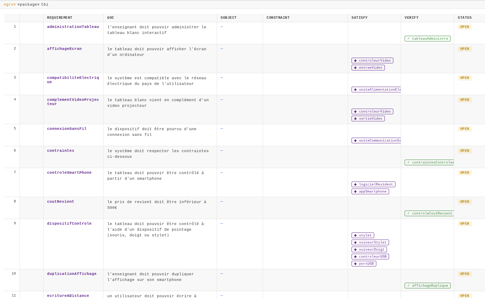
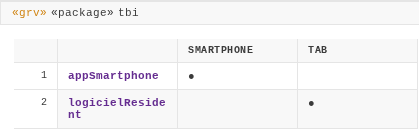

---
title:
- Correction TD 5
subtitle:
- Ingénierie des systèmes
author:
- Jean-Yves Didier
lang:
- french
date:
- 2026-2027
fontsize: 
- 12pt
maxwidth: 
- 80%
mainfont:
- sans-serif
---

<!-- pandoc -s -o corrige_td1.html --syntax-definition ~/sync/config/sysml.xml corrige_td1.md -->

**Avant-propos** : la correction présentée ici concerne l'exemple du tableau blanc interactif, qui est l'exemple le plus traité en profondeur dans le cadre des TDs.

# Reprise des séquences

Nous avions terminé le corrigé de la quatrième séance de TD en donnant la liste des
composants découverts dans le cadre de l'analyse des scénarios de cas d'utilisation.

Pour rappel, voici la liste qui avait été mise à jour :
```{.sysml .numberLines}
package tbi {
    package parts {
        /* acteurs */
        part def Utilisateur;
        part def Enseignant :> Utilisateur;
        part def Etudiant;

        /* contexte */
        part def TableauBlancInteractif;
        part def VideoProjecteur;
        part def SmartPhone;
        part def Stylet;
        part def Souris;

        /* composants ajoutés lors de l'exploration des scénarios */
        part def BoutonMateriel;
        part def Menu;
        part def DialogueReglage;
        part def Reglage;
        part def Item;
        part def AppTBI;
        part def DialogueTableaux;
        part def TableauActif;
        part def Message;
        part def Evenement;
    }
}
```

# Reprise et traçabilité des exigences 

Dans la table des exigences (vue en grille) telle que la génère Aliot SysML v2, il y a plusieurs colonnes nommées **satisfy**, **verify** et **status** que nous allons exploiter pour tracer les exigences. 

* **satisfy** est utilisé pour indiquer que la présence d'un composant satisfait l'exigence.
* **verify** est utilisé dans le cadre d'une procédure qui va vérifier l'exigence.
* **status** est automatiquement mis à jour dès lors que l'exigence est tracée. Cela se traduit alors par le statut **OPEN**.

Voici un aperçu du résultat que l'on peut obtenir dès lors que l'on s'intéresse à la traçabilité des exigences :


Pour chaque exigence, il faut se demander si elle est plutôt associée à une procédure de vérification où si elle
peut être résolue en ajoutant un composant au système. De manière générale, les exigences associées au cas 
d'utilisation seront associées à une procédure de vérification ; c'est ce que l'on effectue dans le cadre d'une 
recette avec le client.

Cela se traduit, dans la version textuelle de SysML, de la façon suivante :
```sysml
package recette {
    verification informationSauvegardee {
        verify sauvegardeInformation;
    }
    verification ecritureADistanceOperee {
        verify ecritureADistance;
    }
    verification affichageDuplique {
        verify duplicationAffichage;
    }
    verification surfaceTransformee {
        verify transformationSurface;
    }
    verification tableauAdministre {
        verify administrationTableau;
    }
    verification fonctionsVerifiees {
        verify fonctions;
    }
}
```

De manière à assurer la traçabilité complète, il faut aussi compléter la description des cas d'utilisation comme nous pouvons le voir ci-dessous :
```sysml
use case sauvegarderInformations {
    ref actor utilisateur;
    require sauvegardeInformation;
}
use case dupliquerAffichage {
    ref actor utilisateur;
    require duplicationAffichage;        
}
use case ecrireADistance {
    ref actor utilisateur;
    require ecritureADistance;
}
use case administrerTableau {
    ref actor enseignant;
    require administrationTableau;
}
use case transformerSurfacePlane {
    ref actor enseignant;
    require transformationSurface;
}
```

Pour certaines exigences telles que celles portant sur le poids ou sur le coût de revient
du produit, il s'agit davantage de procédures de contrôle que nous pouvons rajouter de 
la manière suivante :
```sysml
package controle {
    verification contraintesControlees {
        verify contraintes;
    }
    verification controlePoidsTotal {
        verify poidsTotal;
    }
    verification controleCoutRevient {
        verify coutRevient;
    }            
}
```

Enfin, il nous faut ajouter des composants pour satisfaire certaines des exigences (parfois plusieurs composants pour une exigence) :
```sysml 
part controleurVideo : ControleurVideo {
    satisfy affichageEcran;
    satisfy complementVideoProjecteur;
}
part entreeVideo : EntreeVideo {
    satisfy affichageEcran;
}
part uniteAlimentationElectrique : UniteAlimentationElectrique {
    satisfy compatibiliteElectrique;
}
part sortieVideo : SortieVideo {
    satisfy complementVideoProjecteur;
}
part uniteCommunicationSansFil : UniteCommunicationSansFil {
    satisfy connexionSansFil;
}
part logicielResident : LogicielResident {
    satisfy controleSmartPhone;
}
part appSmartphone : AppTBI {
    satisfy controleSmartPhone;
}
part stylet: Stylet {
    satisfy dispositifControle;        
}
part suiveurStylet : SuiveurStylet {
    satisfy dispositifControle;
}
part suiveurDoigt : SuiveurDoigt {
    satisfy dispositifControle;
}
part controleurUSB : ControleurUSB {
    satisfy dispositifControle;
}
part portUSB : PortUSB {
    satisfy dispositifControle;
}
part tbi : TableauBlancInteractif {
    satisfy specificationsTBI;
    satisfy interactionsMaterielles;
}
part boutonMenu : BoutonMateriel {
    satisfy pointAccesUnique;
}
```

Ceci implique ensuite de rajouter les définitions appropriées dans le *package parts* 
que nous avions déjà créé : 
```sysml
/* composants ajoutés lors de l'examen des exigences */
part def ControleurVideo;
part def EntreeVideo;
part def SortieVideo;
part def UniteAlimentationElectrique;
part def UniteCommunicationSansFil;
part def LogicielResident;
part def SuiveurStylet;
part def SuiveurDoigt;
part def ControleurUSB;
part def PortUSB;
```

# Vue arborescente du système 

A ce stade, la correction ne pourra être que partielle car nous n'avons exploré ni l'ensemble des cas d'utilisation, ni la totalité des scénarios associés.

## Architecture physique

Dans l'architecture physique, nous avons pour l'instant recensé les composants suivants :
*TableauBlancInteractif*, *Stylet*, *BoutonMateriel*, *ControleurVideo*,
*EntreeVideo*, *SortieVideo*, *UniteAlimentationElectrique*, *UniteCommunicationSansFil*,
*SuiveurStylet*, *SuiveurDoigt*, *ControleurUSB*, *PortUSB*.

Certains composants semblent relever de ce que l'on pourrait trouver sur une carte mère donc nous pourrons rajouter quelques éléments intermédiaires.

Au niveau du langage textuel SysML, cela se traduit par l'extrait suivant :
```sysml 
part tbi : TableauBlancInteractif {
    part boutonMenu : BoutonMateriel;
    part carteMere : CarteMere {
        part microControleur : MicroControleur;
        part controleurVideo : ControleurVideo;
        part entreeVideo: EntreeVideo;
        part sortieVideo: SortieVideo;
        part uniteCommunicationSansFil : UniteCommunicationSansFil;
        part controleurUSB : ControleurUSB ;
        part portUSB : PortUSB;
    }
    part suiveurStylet : SuiveurStylet;
    part suiveurDoigt : SuiveurDoigt;
    part uniteAlimentationElectrique : UniteAlimentationElectrique;
}
```

## Architecture logique
Dans ce système, il y a en réalité deux architectures logiques : l'une pour le logiciel résident (logiciel embarqué)
du tableau blanc interactif, l'autre pour l'application sur le smartphone. 

Le logiciel résident contient *Menu*, *DialogueReglage*, *Reglage* et *Item*.

L'application sur smartphone contient *DialogueTableaux*, *TableauActif*, *Message*, *Evenement*.

Ceci se traduit par l'extrait SysML suivant :
```sysml 
part logicielResident : LogicielResident {
    part menu : Menu;
    part dialogueReglage : DialogueReglage[1..*];
    part reglage : Reglage[0..*];
    part items : Item[0..*];
}

part appSmartphone : AppTBI {
    part dialogueTableaux: DialogueTableaux;
    part tableauActif : TableauActif;
    part messages : Message[0..*];
    part evenement : Evenement[0..*];
}
```

L'ensemble des architectures peut-être représenté comme suit :




# Interconnexions 

L'architecture physique sur laquelle des interconnexions peuvent être mises en évidence.
Cela peut impliquer de transformer des composants (*parts*) en *ports* si leur nature s'y prête davantage.


Une première esquisse des interconnexions peut être représentée comme suit :


Le code en SysML est alors le suivant : 
```sysml
part tab : TableauBlancInteractif {
    in port boutonMenu : BoutonMateriel;
    
    part carteMere : CarteMere {
        part microControleur : MicroControleur;
        part controleurVideo : ControleurVideo;
        in port entreeVideo: EntreeVideo;
        out port sortieVideo: SortieVideo;
        part uniteCommunicationSansFil : UniteCommunicationSansFil;
        part controleurUSB : ControleurUSB ;
        inout port portUSB : PortUSB;
        in port alimentation ;

        connect entreeVideo to controleurVideo;
        connect sortieVideo to controleurVideo;
        connect microControleur to controleurVideo;
        connect microControleur to uniteCommunicationSansFil;
        connect microControleur to controleurUSB;
        connect controleurUSB to portUSB;
    }

    part suiveurStylet : SuiveurStylet;
    part suiveurDoigt : SuiveurDoigt;
    part uniteAlimentationElectrique : UniteAlimentationElectrique {
        out port basseTension;
        in port hauteTension;
    }

    inout port portUSB : PortUSB;
    in port hauteTension;
    in port entreeVideo;
    out port sortieVideo;

    connect boutonMenu to carteMere;
    connect carteMere.portUSB to portUSB;
    connect suiveurStylet to carteMere;
    connect suiveurDoigt to carteMere;
    connect hauteTension to uniteAlimentationElectrique.hauteTension;
    connect entreeVideo to carteMere.entreeVideo;
    connect sortieVideo to carteMere.sortieVideo;
    connect uniteAlimentationElectrique.basseTension to carteMere.alimentation;
}
```

# Allocations

Pour terminer, les allocations permettent de détepart smartPhone:SmartPhone;

allocate appSmartphone to smartPhone;
allocate logicielResident to tab;
rminer quelle partie physique va avec quelle partie logique.

Pour cela, nous pouvons compléter la description avec le mot-clé *allocate* comme ci-dessous. 
Nous avons, au passage, ajouté une instance de smartphone pour réaliser l'allocation.

```sysml
part smartPhone:SmartPhone;
allocate appSmartphone to smartPhone;
allocate logicielResident to tab;
```

La matrice résultante est la suivante :

